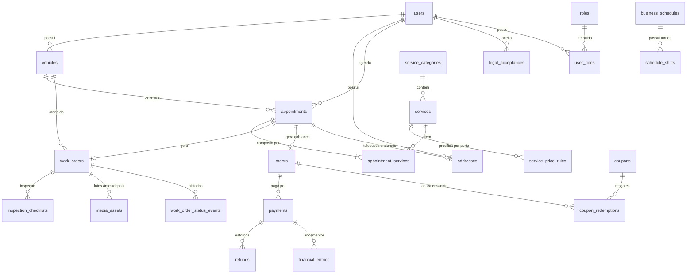

# Studio 85 — Sistema Integrado de Gestão para Lava-Rápido e Estética Automotiva

> **Status:** Fase 0 — Planejamento, Arquitetura e Conformidade de Segurança  
> **Versão do Documento:** 1.0.0  
> **Política de Segurança Obrigatória:** Conforme [`forestsecurity.md`](.agents/forestsecurity.md) e boas práticas OWASP ASVS / LGPD.

---

## 1. Visão Geral do Produto

O **Studio 85** é uma plataforma moderna, intuitiva e altamente segura projetada para gestão operacional, financeira e de relacionamento com clientes de lava-rápido e centros de estética automotiva. O sistema abrange dois ambientes integrados:

1. **Painel Administrativo & Operacional (Web Desktop/Mobile):**
   - Gestão de capacidade operacional por turnos flexíveis e horários (modelo configurável inspirado no Luara).
   - Suporte a múltiplos veículos simultâneos por horário/box (capacidade paralela).
   - Gestão completa de ordens de serviço (OS) com checklist de entrada (avarias, pertences, combustível/km).
   - Upload privado de fotos **Antes & Depois** vinculadas à OS com controle de visibilidade para o cliente.
   - Ponto de venda (PDV) / Caixa, conciliação financeira e pagamentos (Online via Pix/Cartão e Presencial na retirada).
   - Relatórios executivos diferenciando faturamento bruto, vendas confirmadas, liquidação bancária e cancelamentos.
   - Preparado para ativação de **Telebusca (Leva-e-Traz)** com controle de endereços do cliente e taxas.

2. **Portal do Cliente (PWA Mobile-First & Desktop):**
   - Autocadastro com validação de CPF e verificação de e-mail por código de uso único.
   - Gestão da garagem do cliente (múltiplos veículos com validação de placa Mercosul e antiga, ou identificador interno).
   - Agendamento ágil de serviços com precificação dinâmica por categoria de porte do veículo.
   - Opção de agendamento de Telebusca (quando habilitada no Admin), permitindo selecionar o endereço cadastrado com 1 clique ou indicar o local de coleta do veículo.
   - Acompanhamento em tempo real do status do veículo e galeria de fotos Antes/Depois.
   - Histórico de serviços, faturas e cancelamento automatizado com cálculo de estorno baseado em regras claras.

---

## 2. Conformidade de Segurança (`forestsecurity.md`)

Este projeto segue estritamente a política de segurança definida em [`forestsecurity.md`](.agents/forestsecurity.md). Nenhuma funcionalidade é entregue sem validação contra os seguintes pilares:

### Checklist de Segurança Obrigatório

| Domínio | Requisito ForestSecurity | Implementação no Studio 85 |
|---|---|---|
| **XSS** | Nenhuma entrada sem sanitização/escape | React com JSX seguro; `dangerouslySetInnerHTML` proibido; inputs validados via Zod no backend e frontend; headers CSP restritivos. |
| **IDOR** | Checagem de ownership em toda consulta | Todas as rotas de cliente filtram pelo `userId` autenticado (`where: { id: resourceId, userId: req.user.id }`). Chaves sequenciais não expostas; slugs e UUIDs/CUIDs para identificadores públicos. |
| **Segredos** | Chaves e senhas fora do código | Segredos estritamente em variáveis de ambiente `.env`; `.env.example` sem dados reais; nenhuma chave `VITE_` com privilégio de servidor; verificação em CI contra vazamento. |
| **Infra/Banco** | Banco e filas isolados | MySQL e Redis não expostos diretamente à internet pública; usuários de aplicação com privilégios restritos (sem permissões de DDL desnecessárias em runtime). |
| **Injeções** | SQL, NoSQL e comandos sanitizados | Uso exclusivo de queries parametrizadas via Prisma ORM; proibição de SQL raw concatenado; sem execução de comandos de shell com input do usuário. |
| **Autenticação & Brute Force** | Rate limiting e hash forte | Senhas com **Argon2id**; cookies de sessão com flags `HttpOnly`, `Secure`, `SameSite=Strict`; rate limiting por IP e por conta nas rotas de login, cadastro, verificação e checkout; comparação em tempo constante (`crypto.timingSafeEqual`). |
| **Dependências** | Varredura e ausência de ferramentas de debug em prod | Execução periódica de `npm audit` / `pnpm audit`; lockfiles comitados; exclusão de depuradores em build de produção. |
| **Exposição Externa** | CORS, Webhooks e Mídia Privada | CORS restrito com lista branca de domínios; webhooks de pagamento com validação criptográfica de assinatura (HMAC); fotos de veículos armazenadas em bucket privado com presigned URLs temporárias; validação de upload por magic bytes (MIME type real). |

---

## 3. Stack Tecnológica e Justificativa

### Backend
- **Node.js LTS (v22+) com TypeScript**: Ambiente moderno, estável e com tipagem estrita de ponta a ponta.
- **NestJS (Arquitetura Modular)**:
  - Justificativa: Fornece injeção de dependências limpa (essencial para o desacoplamento de `PaymentProvider` entre Mercado Pago e Stone/Pagar.me), Guards nativos para RBAC e controle de propriedade (anti-IDOR), interceptors para auditoria e mascaramento de logs sensíveis, e gateways WebSocket integrados.
- **Prisma ORM**: Tipagem forte, migrations versionadas e seguras, abstração contra SQL Injection e suporte a transações ACID com locks (`$transaction`).
- **MySQL 8+**: Banco relacional robusto com integridade referencial, foreign keys e índices adequados para concorrência de agendamentos.
- **Redis + BullMQ**: Filas persistentes para processamento de webhooks de pagamento (com garantia de idempotência), disparos de e-mail e bridge de comunicação WhatsApp.
- **Socket.IO (WebSocket Autenticado)**: Notificações e atualizações em tempo real das ordens de serviço.

### Frontend
- **React + TypeScript + Vite**: Renderização rápida, bundle otimizado e DX superior.
- **Tailwind CSS**: Estilização flexível, suporte a temas Claro e Escuro (persisitido) e design mobile-first refinado.
- **TanStack Query (React Query)**: Gerenciamento de estado de servidor, cache, refetching inteligente e sincronização em tempo real.
- **React Hook Form + Zod**: Formulários resilientes com validação server-aligned compartilhada.
- **PWA (Vite PWA Plugin)**: Manifest, Service Worker para cache de assets e instalação nativa em Android e iOS.

### Microserviço WhatsApp Bridge (`services/whatsapp-bridge`)
- **Node.js + Baileys**, no mesmo padrão de rotas do bot do projeto Agenda (estilo Evolution API):
  - `POST /instance/create` (QR code), `GET /instance/connectionState/:i`, `DELETE /instance/delete/:i`,
    `POST /message/sendText/:i` e `POST /message/sendMedia/:i` (fotos como imagem).
  - Autenticação por header `apikey` (= `WHATSAPP_BRIDGE_TOKEN` da API) e webhook de conexão assinado com
    `WHATSAPP_WEBHOOK_SECRET`. Nenhum segredo no código.
  - O backend NestJS envia a confirmação do agendamento e o aviso de carro pronto (com as fotos de depois);
    os textos são editáveis em Configurações e cada envio fica registrado, inclusive falhas.
  - Rodar: `cd services/whatsapp-bridge && cp .env.example .env` (preencher) `&& npm install && npm start`
    (em produção, com PM2: `pm2 start server.js --name studio85-whatsapp --node-args="--env-file=.env"`).
  - A pasta `auth_info/` guarda a sessão do número: não versionar e fazer backup.
  - **Produção (VPS):** roda em `/root/studio85-whatsapp` com PM2 (`studio85-whatsapp`), ouvindo só em
    `127.0.0.1:3085`. O acesso de fora passa pelo nginx em `https://wa.studio85poa.com.br` (certificado do
    certbot). A API usa `WHATSAPP_BRIDGE_URL=https://wa.studio85poa.com.br` e `WHATSAPP_ENABLED=true`.
    Para atualizar o código da ponte: `VPS=root@IP-DA-VPS ./services/whatsapp-bridge/deploy-vps.sh` (chave SSH).

---

## 4. Modelo de Agenda e Capacidade Operacional (Inspirado no Luara + Flexibilidade Lava-Rápido)

O modelo de agendamento administrativo baseia-se no fluxo consagrado no projeto **Luara**, expandido com a flexibilidade necessária para uma operação de lava-rápido:

### 1. Gestão por Dias e Turnos Flexíveis
- Cada dia da semana (Domingo a Sábado) pode ser ativado/desativado de forma independente.
- Em cada dia ativo, o administrador configura turnos de atendimento:
  - **Manhã** (ex: 08:00 às 12:00)
  - **Tarde** (ex: 13:00 às 18:00)
  - **Noite** (opcional, para estéticas com plantão ou entrega)
- Intervalo base de slot configurável (ex: 30 min, 45 min, 60 min, etc.).

### 2. Capacidade Simultânea (Múltiplos Carros por Horário)
- Diferente de um salão de atendimento individual, o lava-rápido possui boxes ou equipes simultâneas.
- O administrador define a **capacidade de atendimento paralelo por turno** (ex: 2 ou 3 veículos simultâneos).
- O motor de agendamento valida a disponibilidade em tempo real com controle de concorrência (`SELECT ... FOR UPDATE` e locks temporários de checkout).

### 3. Preparação para Telebusca (Leva-e-Traz)
- No painel administrativo, há uma chave de controle: **Habilitar Telebusca (Leva-e-Traz)**.
- Quando desabilitada, o cliente apenas agenda a entrega do veículo no local.
- Quando habilitada pelo Admin:
  - O cliente visualiza a opção "Solicitar Telebusca" no fluxo de agendamento.
  - Com **1 clique**, o cliente escolhe o endereço já cadastrado no seu perfil ou informa um novo endereço de coleta/entrega.
  - O sistema calcula e exibe a taxa configurada no Admin.
  - A OS é criada com marcadores de rota e status de coleta.

---

## 5. Diagrama Entidade-Relacionamento (ERD Inicial)

### Principais Entidades

1. **`users`**: Cadastro de administradores, atendentes, lavadores e clientes. Campos protegidos para CPF (com lookup hash para busca sem descriptografia em massa).
2. **`addresses`**: Endereços salvos dos clientes para facilidade de agendamento de Telebusca com 1 clique.
3. **`vehicles`**: Garagem dos clientes (placa antiga/Mercosul, marca, modelo, ano, cor, porte: Pequeno, Médio, SUV/Grande, Picape).
4. **`services` & `service_price_rules`**: Catálogo e precificação dinâmica vinculada ao porte do veículo.
5. **`business_schedules` & `schedule_shifts`**: Configuração semanal de turnos, horários e capacidade simultânea de veículos.
6. **`appointments` & `appointment_holds`**: Reservas com snapshot de preços e regras de cancelamento; bloqueio temporário anti-overbooking durante o checkout.
7. **`work_orders` & `media_assets`**: Ordem de serviço, checklist inicial de avarias e galeria privada de fotos Antes e Depois.
8. **`payments`, `refunds` & `financial_entries`**: Registro financeiro em centavos com suporte a Mercado Pago, Stone e pagamento na retirada.
9. **`webhook_inbox` & `audit_logs`**: Processamento de eventos externos com idempotência e trilha de auditoria completa para ações administrativas.

---

## 6. Política de Cancelamento e Reembolso

Conforme a especificação comercial:
- **Cancelamento com $\ge$ 4 horas de antecedência do início agendado:**
  $$\text{Reembolso} = 100\% \text{ do valor efetivamente pago}$$
- **Cancelamento com $<$ 4 horas de antecedência:**
  $$\text{Reembolso} = 50\% \text{ do valor efetivamente pago}$$
- **Regras Operacionais e Legais:**
  - Descontos promocionais e cupons não são convertidos em dinheiro; apenas o saldo real debitado é passível de estorno.
  - Reservas confirmadas para "Pagar na Retirada" não geram estornos financeiros, apenas liberação do slot na agenda.
  - O painel administrativo permite aprovação de exceções justificadas (ex: falhas do estabelecimento, força maior ou direito de arrependimento CDC).

---

## 7. Fases de Implementação Sequencial

- [x] **Fase 0 — Segurança e Descoberta:**
  - Localização e leitura integral de `forestsecurity.md`.
  - Elaboração do checklist de segurança e conformidade.
  - Mapeamento das convenções do projeto de referência (Luara) e definição arquitetural.
- [ ] **Fase 1 — Base & Infraestrutura:**
  - Monorepo modular (`apps/api`, `apps/web`, `services/whatsapp-bridge`, `infra`).
  - Docker Compose para MySQL 8, Redis e API.
  - Setup do Prisma ORM com migrations iniciais, sementes e RBAC.
  - Autenticação robusta (Argon2id, JWT em cookies seguros, rate limit, anti-CSRF).
- [ ] **Fase 2 — Cadastros & Catálogo:**
  - Autocadastro de usuários e ativação por e-mail (código único com cooldown).
  - Gestão de veículos e validações de placas brasileiras.
  - Catálogo de serviços, adicionais e precificação por porte de veículo.
- [ ] **Fase 3 — Agenda Flexível & Telebusca:**
  - Motor de disponibilidade e cálculo de slots por turnos (modelo Luara + capacidade simultânea).
  - Bloqueio temporário durante checkout (`holds`) e prevenção de corrida.
  - Suporte à Telebusca configurável no Admin com seleção de endereço em 1 clique.
- [ ] **Fase 4 — Operação & Ordens de Serviço (OS):**
  - Fluxo completo: check-in, checklist de inspeção de avarias, fotos Antes/Depois.
  - Armazenamento privado de imagens com URLs pré-assinadas temporárias.
  - Notificações em tempo real via WebSocket para acompanhamento do cliente.
- [ ] **Fase 5 — Pagamentos & Integrações:**
  - Interface desacoplada `PaymentProvider`.
  - Adaptadores para Mercado Pago (Pix/Cartão) e Stone/Pagar.me.
  - Pagamento na retirada com quitação manual no caixa do admin.
  - Webhooks com verificação criptográfica de assinatura e idempotência em banco.
- [ ] **Fase 6 — Comunicação & Cupons:**
  - Integração com e-mails transacionais.
  - Bridge com o microserviço Python na VPS para notificações via WhatsApp.
  - Gestão de cupons com travas de uso e limites por cliente.
- [ ] **Fase 7 — Painel Financeiro, PWA & Acessibilidade:**
  - Dashboard analítico com distinção de vendas, pagamentos confirmados e valores liquidados.
  - Modos Claro e Escuro, PWA instalável, conformidade WCAG 2.2 AA.
- [ ] **Fase 8 — Qualidade, LGPD & Lançamento:**
  - Páginas públicas de termos, privacidade e retenção de dados.
  - Testes E2E e testes de segurança automatizados.
  - Manual de operação, deploy e rotinas de backup.

---

## 8. Deploy em produção (um único app Node)

A API (NestJS) também serve o site compilado (`apps/web/dist`), então a produção é **um app Node só**, com o banco MySQL. Funciona em app Node.js da Hostinger (planos Business/Cloud) ou em qualquer VPS.

| Campo | Valor |
|---|---|
| Versão do Node | 20 ou 22 |
| Comando de build | `npm run build` |
| Arquivo de entrada / start | `server.js` (`npm start`) |

O `server.js`:

1. Carrega as variáveis de `ENV_FILE`, `../studio85.env` ou `~/studio85.env`, que ficam fora da pasta do app e sobrevivem a cada novo deploy. Variáveis definidas no painel têm prioridade. Na Hostinger elas ficam em `hbuilds/config/.env` e só entram em vigor no próximo build (um push no `main` dispara o build); reiniciar não basta.
2. Aplica as migrações pendentes (`prisma migrate deploy`).
3. No primeiro boot, com o banco vazio, roda o seed: serviços, horários, termos, mensagens e o admin de `SEED_ADMIN_EMAIL` / `SEED_ADMIN_PASSWORD`, que precisa ter 8 ou mais caracteres. Enquanto não existir um admin, o seed roda de novo a cada boot; depois disso, não roda mais.
4. Guarda fotos e comprovantes em `STORAGE_LOCAL_PATH`, ou em `~/studio85-storage` se ela não estiver definida. Use sempre um caminho **absoluto** fora da pasta do deploy: na Hostinger o app roda em `hbuilds/versions/<id>/`, que é apagada a cada deploy. Em produção: `/home/u433815487/domains/studio85poa.com.br/studio85-storage`.

O modelo do arquivo de variáveis é o `apps/api/.env.production`, que fica fora do git. Antes do primeiro boot, preencha:

- `SEED_ADMIN_PASSWORD` (8+ caracteres);
- `SMTP_PASSWORD`, da caixa `nao-responda@` criada em **E-mails** no hPanel. Sem e-mail, o cliente não recebe o código de cadastro.

A ponte do WhatsApp (`services/whatsapp-bridge`) precisa ficar ligada o tempo todo, então deve rodar numa VPS com PM2. Depois disso, ajuste `WHATSAPP_BRIDGE_URL` e `WHATSAPP_ENABLED=true`.

**Avisos (WhatsApp em massa):** no menu Avisos, o dono escreve a mensagem (com `{primeiro_nome}`, `{nome}` e `{empresa}`) e escolhe até 20 contatos por vez: clientes com conta e clientes de balcão com celular, um por número. A fila fica no banco e manda uma mensagem por minuto, só com o número conectado; um lote novo só entra quando o anterior termina. O mesmo número nunca recebe o mesmo aviso duas vezes; quem não recebeu (falha ou envio parado) pode ser escolhido de novo. Cada envio também aparece em Configurações → WhatsApp → Últimos envios.

**Super admin (Plataforma):** o papel `SUPER_ADMIN` é do dono da plataforma e é exclusivo: o `ADMIN` do lava-jato não acessa (`GET /super/overview` responde 403 e a página `/plataforma` não aparece). A página mostra, por período (7, 30 ou 90 dias), visitas, clientes que entraram, cadastros, agendamentos (app e equipe), serviços, pagamentos online e comissão, o funil do agendamento (entrou → abriu o agendamento → escolheu serviço e horário → confirmou) e quem não finalizou (cadastro sem e-mail confirmado ou incompleto, nunca agendou, abriu o agendamento e desistiu). "Clientes que entraram" vem de `user_activity_days`, gravado uma vez por cliente por dia no login (JWT). Visitas e funil vêm de `site_events`: o navegador manda um código aleatório que vale só enquanto a aba está aberta (sem cookie e sem dado pessoal), cada etapa conta uma vez por aba por dia, e robôs e a equipe do lava-jato não contam. A medição está descrita na Política de Privacidade (versão 1.1).

---

## 9. Pagamento online (Pagar.me com split) e Receita

O pagamento online é **opcional**: o cliente paga agora pelo app (Pix ou cartão) ou na loja, como antes. O split vale em toda cobrança:

| Recebedor | Parte | Taxas, arredondamento, estorno e chargeback |
|---|---|---|
| Lava-jato | 98% | pagas por ele (`liable`, `charge_processing_fee`, `charge_remainder_fee`) |
| Plataforma | 2% (`PAGARME_PLATFORM_FEE_PERCENT`; o admin pode mudar por recebedor) | nenhuma |

O checkout só aparece com as chaves configuradas e o recebedor do lava-jato **Liberado** no Pagar.me. Isso exige cadastro e verificação de identidade em Financeiro → Pagamentos online → Recebedor.

Com `PAGARME_FALLBACK_TO_PLATFORM=true` (modo temporário), o checkout abre mesmo sem o recebedor do lava-jato: o valor cai inteiro na conta da plataforma, sem divisão. Quando o recebedor for liberado, a divisão volta sozinha.

**Pagamento no app (chave do dono):** em Configurações → Pagamento no app, o dono pode desligar o pagamento online. Desligado, o app não oferece Pix nem cartão, a API recusa novas cobranças e novas assinaturas, e tudo é pago no local. Pagamentos já feitos, reembolsos, webhooks e a cobrança de quem já assina continuam funcionando.

**Taxa do cartão paga pelo cliente:** as taxas do contrato com o Pagar.me são da plataforma e ficam no servidor, em `PAGARME_FEE_CARD_PERCENTS` (% por número de parcelas, em ordem: `3.89,4.18` = 1x 3,89% e 2x 4,18%). No cartão o cliente paga o serviço mais a taxa, em item separado do pedido, inclusive em 1x; descontada a taxa, chega o preço do serviço. No Pix e no pagamento no local o cliente paga só o serviço. O dono só escolhe, em Configurações → Parcelamento no cartão, até quantas vezes aceita parcelar, limitado às parcelas com taxa definida. Na Receita a taxa não conta como faturamento.

**Variáveis** (modelo em `infra/.env.example`):

- `PAGARME_SECRET_KEY` e `PAGARME_PUBLIC_KEY`;
- `PAGARME_PLATFORM_RECIPIENT_ID`, o recebedor da comissão;
- `PAGARME_PLATFORM_FEE_PERCENT=2`;
- `PAGARME_SOURCE_TAG=studio85`;
- `PAGARME_FALLBACK_TO_PLATFORM` (temporário, ver acima);
- opcionais: `PAGARME_WEBHOOK_USER` e `PAGARME_WEBHOOK_PASS`, para Basic Auth no webhook.

Na Hostinger elas ficam no painel do app e só valem depois do próximo build.

**Rotas** (prefixo `/api/v1`, exceto o webhook):

| Rota | O que faz |
|---|---|
| `GET payments/online/config` | pagamento online disponível? E a chave pública para gerar o token do cartão |
| `POST appointments/:id/payments/pix` | gera o Pix (expira em 30 min; pedir de novo reaproveita o mesmo) |
| `POST appointments/:id/payments/card` | cobra o cartão. Só recebe o `card_token`: o número do cartão vai direto do navegador para o Pagar.me |
| `GET payments/:id` | situação do pagamento; reconsulta o Pagar.me no máximo a cada 5 s |
| `GET/PUT admin/payments/recipient` | recebedor do lava-jato (pessoa física ou empresa, conta bancária, transferência diária) |
| `POST admin/payments/recipient/kyc-link` | gera o link de verificação de identidade |
| `POST admin/payments/recipient/refresh` | atualiza o status do recebedor |
| `GET admin/payments/summary` | resumo do período |
| `GET admin/payments` | lista de pagamentos online |
| `POST admin/payments/:id/refund` | estorno total ou parcial |
| `GET admin/payments/webhook-events` | eventos recebidos |
| `POST …/:id/reprocess` | reprocessa um evento |
| `GET admin/revenue` | Receita: indicadores, demonstrativo, gráficos e comparação com o período anterior |
| `GET/POST/PUT/DELETE admin/subscriptions/plans` | planos de assinatura montados pelo dono |
| `GET/POST admin/subscriptions` | assinantes; ativar um plano para um veículo do cliente (gera o link do cartão) |
| `POST admin/subscriptions/:id/link · cancel · refresh` | novo link do cartão, cancelar (para a recorrência), consultar o Pagar.me |
| `GET/POST subscriptions/setup/:token` | página privada do link: o cliente cadastra o cartão e a recorrência começa |
| `GET subscriptions/mine` | assinaturas ativas do cliente logado (vazio para quem não assina) |
| `POST /api/webhook/pagarme` | webhook (endereço cadastrado no painel do Pagar.me) |

**Webhook:** a conta é compartilhada com outros sistemas, então ele segue estas regras:

- Evento sem `metadata.source=studio85` e sem registro local recebe 200 e é ignorado.
- Cada `event_id` é processado uma vez só.
- O recurso sempre é reconsultado na API antes de mudar o banco; o conteúdo do aviso nunca é usado como verdade.
- Falhas são refeitas sozinhas até 5 vezes (30 s, 1 min, 2 min, 4 min), sem fila externa. A cada 5 min o sistema retoma eventos pendentes, inclusive depois de reiniciar.
- Eventos `subscription.*` e `invoice.*` das assinaturas seguem as mesmas regras.
- A cada 2 min o sistema também reconsulta os pagamentos em aberto e as assinaturas que podem ter mudado, então nada fica parado se um aviso se perder.

**Assinaturas:** só existem no painel (Configurações → Assinaturas → Liberadas; o site não divulga).

- O dono monta cada plano do zero: até 4 serviços do catálogo, lavagens por mês e preço mensal por porte.
- Ele ativa o plano para um veículo do cliente e manda o link privado, que vale 7 dias. O cliente cadastra o cartão e o Pagar.me cobra todo mês, com a taxa do cartão por conta do cliente e a mesma divisão 98/2.
- Cada mensalidade paga vira um pagamento no Caixa e na Receita (linha "Assinaturas").
- Dentro do período pago, os serviços do plano saem do total ao agendar (app, balcão ou painel) até acabar a cota do mês. Cancelar a lavagem devolve a vaga.
- As regras ficam congeladas na ativação: mudar o plano depois não altera quem já assina.

**Testar com `sk_test_`:**

1. Preencha as chaves de teste e o recebedor da plataforma.
2. Em Financeiro → Pagamentos online → Recebedor, cadastre os dados e faça a verificação de identidade. No sandbox, o status pode ser aprovado pelo painel do Pagar.me.
3. Clique em "Atualizar status" até aparecer **Liberado**.
4. Como cliente, agende e use "Pagar agora". O Pix de teste é confirmado pelo painel do Pagar.me; o cartão aprovado usa os cartões de teste da documentação.
5. Confira o split no painel do Pagar.me, o pagamento em Pagamentos online, os eventos na aba Eventos e os números em Financeiro → Receita.
6. Faça um estorno parcial e confira o status "Estorno parcial", a comissão recalculada e o Caixa.

---

## 10. Licença e Confidencialidade

Propriedade privada. Uso restrito e exclusivo do estabelecimento contratante. Proibida a distribuição pública de segredos, códigos-fonte ou esquemas de segurança.
